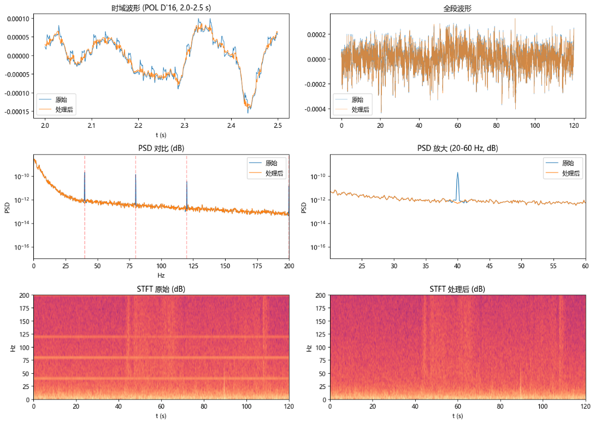
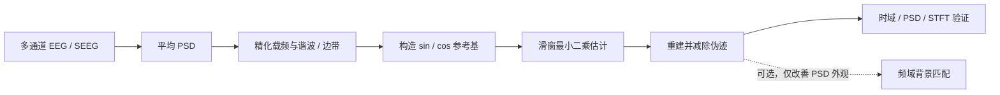

# tACS / Hi-tACS 刺激伪迹去除

> 基于先验频率的滑窗最小二乘正弦对消方法，用于 EEG / SEEG 刺激期间的窄带伪迹建模与讨论。

**文档型研究原型，不是经过临床验证的软件包。** 当前仓库整理了算法原理、参数建议、验证思路，以及一份依赖本地 EDF 文件的示例脚本。脚本尚未封装成通用命令行工具；使用前应先审查实现并在自己的数据上验证。

## 处理结果示例

下图对比了单通道的时域波形、功率谱密度（PSD）和时频图（STFT）。目标刺激频率附近的窄带峰在处理后明显降低，可直观看到该方法的效果。

> 此图是示例结果，不代表临床有效性或所有数据上的信号保真度。请结合自己的数据和研究问题进行验证。

## 方法一览

方法假设伪迹主要由已知载频附近的窄带正弦分量构成。每个候选频率使用正弦和余弦两列表示任意相位；滑窗拟合允许幅度和相位随时间缓慢变化，再将拟合波形从观测信号中减去。

## 仓库内容

| 路径 | 内容 |
| --- | --- |
| [`docs/algorithm.md`](docs/algorithm.md) | 完整算法说明及原始 Python 示例 |
| [`assets/result-comparison.png`](assets/result-comparison.png) | 原始处理结果图 |

## 重要使用边界

- 与目标脑活动同频的成分可能被一并拟合并去除；应评估频率重叠和信号保真度。
- 滑窗最小二乘会改变伪迹频率附近的谱形。**功率或连接性分析不要启用频域背景匹配**；该步骤只是人为抬高 FFT 幅度，不是信号恢复。原始示例会执行这一步，定量分析前必须在脚本中移除/禁用对应调用。
- 示例脚本将输入 EDF 文件名、展示通道和若干参数写在代码中，且依赖具体数据结构；它不是开箱即用的批处理工具。
- 处理前保留不可变的原始数据副本，并记录采样率、参考方式、通道选择、参数、代码版本及处理前后质控结果。
- 本方法不处理刺激开关瞬态，也不替代针对特定设备、范式和研究问题的验证。

## 建议的验证

1. 查看处理前后的时域波形与 PSD，确认抑制集中在目标频率及其预期谐波/边带。
2. 检查非目标频段、相位相关指标和目标神经信号是否受到影响。
3. 用已知信号注入、无刺激数据或其他合适对照评估信号保留能力；报告参数敏感性和失败情形。
4. 报告处理前后伪迹频率功率变化，但不要把功率下降本身当作脑信号恢复的证据。

## 环境与示例

原始示例依赖 Python 以及 `numpy`、`matplotlib`、`mne`、`scipy`。它从 EDF 读取数据并将结果写回本机路径。请先阅读 [`docs/algorithm.md`](docs/algorithm.md) 中的完整代码，替换输入文件、检查通道索引与采样率，并在副本上运行；当前仓库没有提供 EEG 数据。

## 许可与引用

当前未附加开源许可证。公开前请确认你有权分享这些文字、配图和代码，并选择适当的许可证；在许可证明确之前，使用者不应假定获得了复用或再分发授权。
